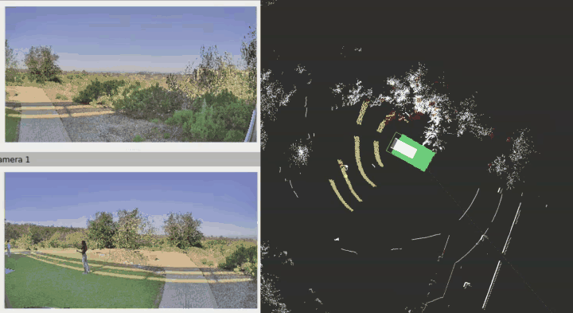
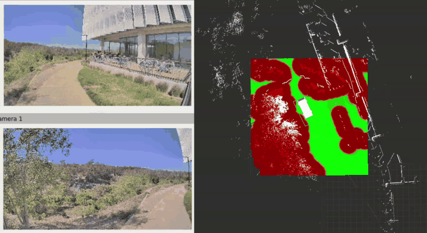
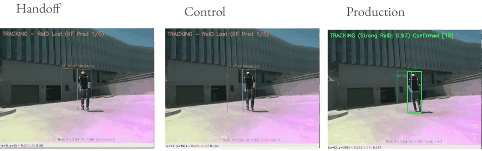
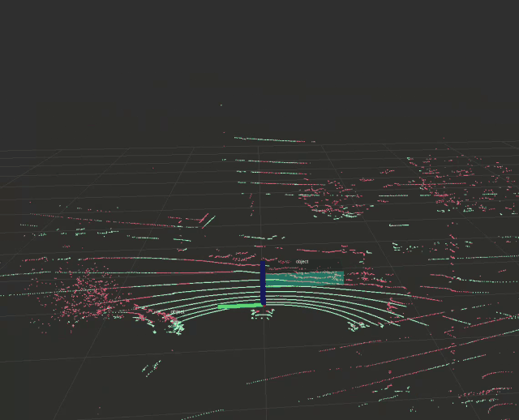
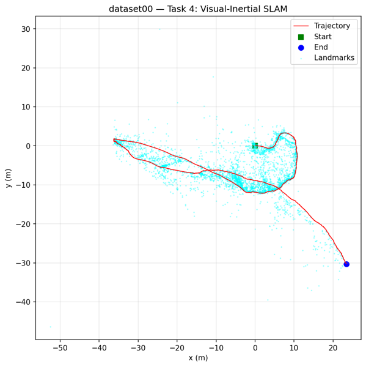
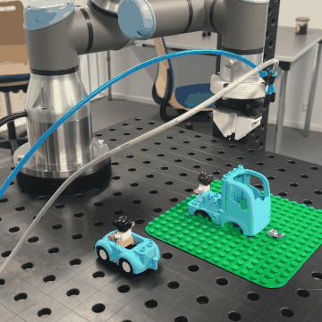
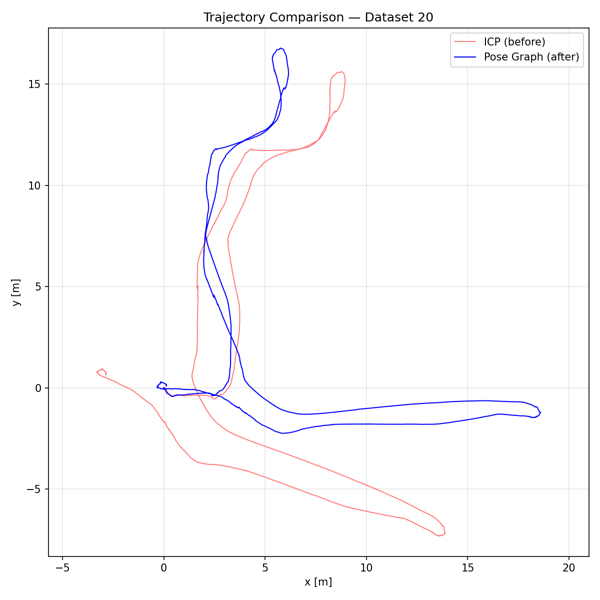
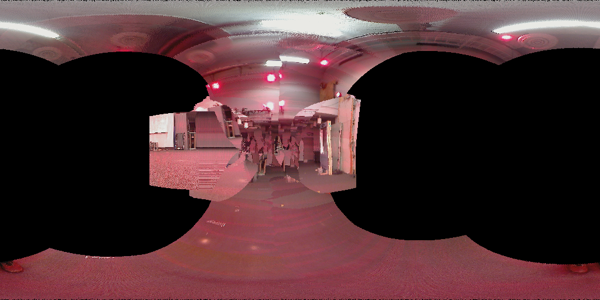

# Jesse Curran

I want robots to sense, plan, learn, and act on their own in the field. I am an M.S. student in Computer Science (Robotics) at UC San Diego, finishing in March 2027.

**Website:** [jesse-curran.github.io/project-portfolio](https://jesse-curran.github.io/project-portfolio/)

[Resume](assets/resume_jessecurran.pdf) · [jecurran@ucsd.edu](mailto:jecurran@ucsd.edu) · [LinkedIn](https://linkedin.com/in/jessecurran) · [GitHub](https://github.com/jesse-curran)

---

## Demos

### Traversability mapping

<table>
<tr>
<td width="50%"></td>
<td width="50%"></td>
</tr>
<tr>
<td>The vehicle scores the terrain around it as it drives. <a href="https://drive.google.com/file/d/1GEUTlW8xf6S9FQKn1Hj8cLjt9QhWOisc/view">Video</a></td>
<td>The planner treats green as free and red as blocked. <a href="https://drive.google.com/file/d/1J1jpboLTH48mWtOJMagFSADcMSq-2Yyy/view">Video</a> · <a href="https://drive.google.com/drive/folders/1aIm6Ej1MbcgjwUutnlQ2ZSbl6wjdA8O6">All clips</a></td>
</tr>
</table>

Traversability is how easily a vehicle can drive over a patch of ground. My map estimates it from two sources. The LiDAR measures shape: slope, roughness, and step height. The cameras identify what the ground is, such as path, grass, or brush. I combine the two into one cost that the Nav2 planner uses to choose a route.

### Person following on a CPU

A Spot robot follows one person using only an RGB-D camera and a CPU. Its most dangerous error is following the wrong person. The three panels replay the same recording through three versions of the system. A green box means the robot is locked on the right person.

- **Handoff** is the system as I received it.
- **Control** is the same logic running on my faster detector.
- **Production** is my identity layer, which keeps learning the person's appearance as conditions change.

| Section | Handoff | Control | Production |
|---|---|---|---|
| Outdoor | 0.343 | 0.454 | **0.644** |
| Sun to shade | 0.098 | 0.186 | **0.500** |
| Indoor | 0.207 | 0.227 | **0.577** |

The scores are F-scores, the harmonic mean of recall and precision. Production scores highest in every section. Its precision stays at 0.976 or higher, so almost every frame it locks on shows the right person. The largest gain is in the passage from sun to shade, the case where the original system failed. [Full video](https://docs.google.com/videos/d/1tnw38e2yC2o_S_IRQn3Sl8Zu3tP0-nNNbav365rLAkU/edit?usp=sharing)

### LiDAR obstacle detection

My C++ pipeline removes the ground from each LiDAR scan. It then groups the remaining points into objects and boxes each one.

---

## Experience

**Graduate Researcher, Autonomous Vehicles Lab, UC San Diego** · Jan. 2026–present · Advisor: Henrik I. Christensen
- I work on autonomy for a ground vehicle and drones that operate together, on and off road. A paper is in preparation.
- I built the traversability map shown above in ROS 2. It is built from published methods, and I wrote the cost policy that ties them together.
- I built the vehicle's Nav2 navigation stack and drove a GEM e6 autonomously for 0.5 miles.
- I set up FAST-LIO2 localization, which fuses LiDAR and IMU data, and measured its error over a 1-mile route.
- I ran drone flights alongside the vehicle in joint field tests.

**Person-following research** · 2026 · with Julian Raheema, paper in preparation
- I redesigned the identity layer of a Spot follower to run on a CPU at 10.5 frames per second, the demo above.

**Robotics Autonomy Engineer Intern, NIWC Pacific** · Oct. 2026–present
- I work on drone-swarm and UAV autonomy for the RESTORE Lab.

---

## Course projects

| | Project | What I did |
|---|---|---|
| | **Mobile robot** (CSE 276A) | I built a ROS 2 robot that drives itself. An extended Kalman filter (EKF) combines AprilTag sightings with wheel odometry to estimate the robot's position. A PID controller follows the planned path. |
|  | **Visual–inertial SLAM** (ECE 276A) | I built a map and a trajectory at the same time from an IMU and a stereo camera. The IMU predicts motion. Landmarks seen by the camera correct the prediction. |
| | **Voice-controlled robot battle** (CSE 276B, Human–Robot Interaction) | Two players command robot Pokémon by voice. I programmed the Mini Pupper quadruped that plays Pikachu and helped write the game controller. The study asks whether a robot's expressive reactions change how players see it. |
|  | **LEGO assembly with a UR3e arm** (Summer school, University of Southern Denmark and the LEGO Group) · [Video](https://drive.google.com/file/d/16VE3l8VNajLJWVrzGNcjO5g4zo6eHGdd/view) | I programmed a robot arm to pick LEGO parts and place them on a baseplate. |
|  | **LiDAR SLAM** (ECE 276A) · [Maps](assets/figures/occupancy_texture_map.png) | I matched consecutive LiDAR scans with ICP to estimate motion. Matching scans alone lets error build up over the route (red). Loop closure recognizes a place seen before and removes that error (blue). |
|  | **Orientation estimation** (ECE 276A) | I estimated a camera's orientation from IMU data. I checked the estimate by using it to stitch the camera's images into a panorama. |

---

## Skills

- **Languages:** Python, C++, C
- **Robotics:** ROS 2, Nav2, PX4, GTSAM, FAST-LIO2
- **Perception:** PyTorch, OpenCV, TensorRT, OpenVINO, YOLO
- **Hardware:** LiDAR, RealSense, IMUs, Spot, PX4 drones, GEM e6, UR3e
